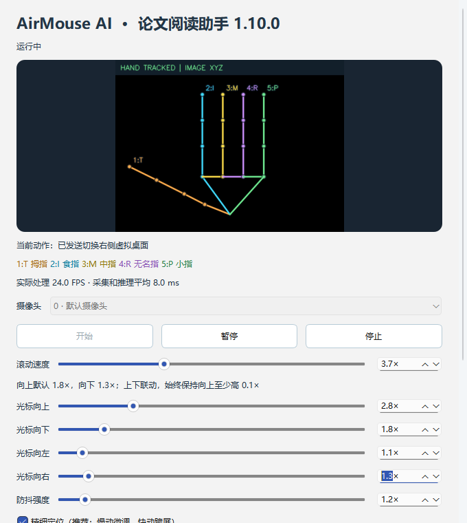
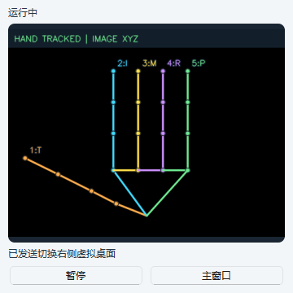

# AirMouse AI · 让手指成为你的鼠标

**Touchless Windows control. Offline. Both hands welcome.**

[下载 Windows 便携版](https://github.com/DangTianqi/AirMouse-AI/releases/latest) · [完整使用说明](docs/使用说明.md) · [更新说明](docs/更新说明.md) · [测试记录](VALIDATION.md)

当前版本 **v1.10.0**。用摄像头识别手指，以轻微动作完成指针移动、阅读滚动、点击拖动和桌面操作。

Windows x64 离线手指微动助手，左右手均可，每次跟踪一只手。支持光标、双指弯曲滚动、真实左键按下/释放和拖拽、右击及 Ctrl+Q。启动默认停止，无账号、录像或上传。

## 使用

从 [Releases](https://github.com/DangTianqi/AirMouse-AI/releases/latest) 下载 AirMouseAI-v1.10.0-Windows-x64.zip，完整解压，运行 AirMouseAI/AirMouseAI.exe，保留 _internal。无需Python或管理员权限。详见 [使用说明](docs/使用说明.md)；随包提供 HTML/TXT说明、更新说明、测试记录和许可。GitHub 的“Download ZIP”下载的是源码，不包含已打包程序。

## 界面预览




截图使用合成手部骨架演示界面，并非录制的真人摄像头画面。

| 操作 | 手势（未指定的手指全部收起） |
| --- | --- |
| 光标 | 单独食指、中指或无名指，活动该指尖 |
| 冻结光标 | 小指自然伸出/接近伸直即锁定位移，明确收拢120ms后解锁；其他命令不受阻，捏合按住时保留左键按住 |
| 回到屏幕中心 | 五指全部收起握拳（含拇指）保持0.5秒，每次保持一次；伸开0.3秒可再触发，后续单指重新锚定 |
| 向上滚 | 食指＋中指或中指＋无名指，先伸直再一起弯曲，拇指收起 |
| 向下滚 | 同上两组，加拇指伸直；伸直双指复位无滚动 |
| 左键 | 拇指食指轻捏按下，松开释放，短捏松开即一次单击 |
| 拖拽 | 轻捏超过1秒后移动捏合中点，持续按住直至松开 |
| 右击 | 拇指＋小指伸直，稳定0.18秒一次 |
| 五指桌面操作 | 五指张开确认0.12秒直接触发任务视图，保持只发一次；继续左右划切桌面、下划显示/还原桌面一次，取消上划；换其他手形0.3秒后开始下一轮 |
| Ctrl+Q | 无名指＋小指伸直，稳定0.8秒一次；该组合不滚动 |
| 暂停/继续 | Ctrl+Alt+G 或按钮，暂停回收摄像头和模型 |

默认向上1.8×、向下1.3×、左右各1×，滚动2×。上下滑块联动，保证上至少比下高0.1×：上0.6–10×，下0.5–9.9×；左右/滚动/防抖0.5–10×。方向以镜像后的屏幕方向为准，普通移动和拖拽共用，无额外总倍率。旧设置迁移不重复放大。小指伸直不取消滚动，方向仍只看拇指；也不阻止握拳回中。

Ctrl+Q首次可直接做目标手势；重复前与右击一样，需其他有效姿态0.3秒重新武装。短暂临界帧最多120ms暂停计时而不立即清零，仅明确识别累计800ms才触发；持续不确定不发送。界面显示确认进度、触发/发送结果与实体键占用阻止原因。Ctrl+Q只发送组合键，无内置功能含义。三维世界关节优先，缺失时使用图像XYZ；骨架固定编号1:T拇指、2:I食指、3:M中指、4:R无名指、5:P小指。严重遮挡或模型检测失败时不能保证识别，模拟旋转不等于真人全角度准确率。

五指命令独立于小指移动锁，不产生光标位移。固定映射Win+Ctrl+左右箭头、Win+Tab、Win+D；不跟随系统触控板自定义，不自动创建桌面。微软参考：[触控板手势](https://support.microsoft.com/en-us/windows/hardware/input-devices/touch-gestures-for-windows)、[Windows快捷键](https://support.microsoft.com/en-us/accessibility/windows/keyboard-shortcuts-in-windows)。

光标四方向、滚动、防抖的6项倍率均支持数字框直接键入，回车/失焦提交，与滑块双向同步并自动保存。上下仍按最后编辑方向联动，保持向上更高。

五指确认后静态触发一次任务视图，左右/下划仍从首次有效手形开始记录，短暂临界识别保留起点；采用三根长指一致的稳健位移，拇指只需保持张开，不要求与长指同等位移。界面显示缺少手指、确认/划动进度及发送结果。旧四指收拇指不再发送桌面命令。

“精细定位”默认开启，连续同向微动使用更低死区/慢速增益并保留小数像素，反向重新采纳明确微动，停手回到静止噪声门槛；快动仍加速。关闭可使用普通响应。布尔偏好保存，旧v6配置缺字段时默认开启，不修改六项既有倍率。

## 置顶悬浮预览

主窗口勾选“置顶悬浮小窗”开启，取消或关闭小窗禁用。原生窗口始终置顶、标题栏拖动、边框缩放，位置/大小/开关自动保存；断开旧显示器时恢复到可见屏幕。主窗口最小化后小窗仍可见，提供同一摄像头的预览、状态、开始/暂停/继续和恢复主窗口按钮。

小窗复用10FPS有界预览，不开第二相机/模型。仅显示小窗时也可关闭主窗口预览；两处预览均不可见时停止绘制。关闭小窗不停止识别，关闭主窗口才完全退出；启动默认不打开相机。

## 开发、测试与打包

Python 3.11 x64，项目根目录：

```powershell
powershell -NoProfile -ExecutionPolicy Bypass -File .\scripts\setup.ps1
.\.venv\Scripts\python.exe -m airmouse_ai
.\.venv\Scripts\python.exe -m pytest -q
powershell -NoProfile -ExecutionPolicy Bypass -File .\scripts\build.ps1
```

固定依赖见 requirements-lock.txt：MediaPipe0.10.33、OpenCV contrib4.11.0.86、NumPy2.2.6、PySide6 Essentials6.8.3。模型仅开发构建下载并核对SHA256，终端用户离线运行。

构建依次验证模型、测试、收集许可、PyInstaller onedir、EXE界面/模型子进程自检、生成ZIP并检查CRC/大小/SHA256。仅更新说明可运行 scripts/package_release.py，它不重新编译。

核心：hand_geometry.py三维手指判定，gestures.py纯状态机，cursor.py防抖，five_finger.py五指共同划动，scroll.py弯曲行程滤波，controller.py输入状态锁，windows_input.py Win32 SendInput，ui.py界面，worker.py监督线程，runtime.py视觉子进程。

## 行为与资源设计

普通光标使用指尖相对MCP位移，抵消整手平移；拖拽用进入时掌宽归一化的捏合中点。三点样本拒绝孤立尖峰，连续同向轨迹使用最新点减少一帧延迟；按真实采样时间执行自适应位置低通和逐轴连续软死区，速度越快行程越大、慢动保留小数像素用于精调。取消固定速度低通和反复等待的解锁门槛，安全速度上限按时间计算。外部光标变化、换手指/模式/移动参数时重新锚定；已确认单指在轻弯临界区保持跟踪，明确收拢才退出。滚动记录已伸直的指定双指组合并跟踪弯曲，避免握拳误滚动。

轻捏确认65毫秒发送LEFTDOWN，松开确认40毫秒发送LEFTUP，无额外合成点击。1秒前冻结，之后才允许捏合点移动；有效持续捏合无时长上限。失联、姿态破坏、换手、暂停、停止、错误均释放，恢复时需先张开再捏。输入返回值检查和按键所有权防护保留；实体左键按住时不接管。普通权限不绕过高权限窗口限制。

| 参数 | 默认 |
| --- | --- |
| 模式稳定 / 帧中断保护 | 150 / 250毫秒 |
| 伸指角度 / 直线度 | 食/中/无名指PIP与DIP≥147°、直线度≥0.88；小指自然伸出≥150°/直线度≥0.90；收拢≤135°或直线度<0.82，持续120ms解锁 |
| 弯指角度 / 直线度 | <130°或<0.72 |
| 捏合距离÷掌宽进入/退出 | 0.30 / 0.42 |
| 光标逐轴连续软死区 | 普通/静止0.0075掌宽×防抖；精细同向微动0.00035掌宽×防抖平方根 |
| 光标增益 / 速度加速 / 安全速度 | 1.55 / 精细0.30–1.75、普通0.70–1.75 / 3600物理像素每秒 |
| 自适应低通 | 截止4Hz＋16×归一化速度，导数截止6Hz；按采样时间计算 |
| 滚动弯曲死区 / 增益 / 量子 | 0.018 / 900 / 30 wheel units |
| 相机 / 推理 / 预览 | 请求640×480、30FPS / 24FPS上限 / 480×360、10FPS上限 |

阈值是集中在 config.Tuning 的初值，需真人试用调优。配置版本6，旧默认滚动1×一次性升级到2×，其他自定义值保留；新增悬浮窗开关/布局，v4偏好保留；v1.3默认上下倍率升级为1.8/1.3，其他自定义值保留并约束上>下；更早统一倍率迁移至上1.8倍、下1.3倍、左右原值。旧版骨架显隐偏好保留。Settings保存至 %LOCALAPPDATA%\AirMouseAI\config.json，原子替换、损坏恢复、500毫秒防抖写入；v1配置升级开启骨架，v2/v3/v4/v5/v6保留显隐偏好。

Qt主进程不加载OpenCV/MediaPipe；视觉进程延迟启动，暂停/停止完整回收。采集帧、IPC与预览邮箱有界，最小化/关闭全部预览跳过绘制；降低到15/20FPS可减少计算量。OpenCV和数学线程池默认1，无忙轮询/逐帧日志；日志512KiB×最多3份，无后台服务或开机启动。驱动卡死时监督线程限时回收本程序子进程。实测资源见 VALIDATION.md。

## 诊断与验收

小指锁定在状态机和Controller移动输出处共同约束，不拦截滚动、按键或握拳回中。Ctrl+Q初始已武装，保持/丢失/暂停不重复武装；其他三个手指需收起，拇指临界但未明确伸出可接受。

pytest使用模拟输入；模型集成使用黑帧。额外原生输入诊断 scripts/verify_native_shortcuts.py 使用带唯一标记的测试事件，先验证F24回执，再在临时钩子处拦截桌面组合键，不送到Shell/其他窗口；不记录实体键盘，结束移除钩子。需要桌面权限，探测失败不会尝试桌面组合键；该脚本仅开发验证，不随程序驻留。

独立诊断：

```powershell
.\.venv\Scripts\python.exe scripts/benchmark_cursor.py
.\.venv\Scripts\python.exe scripts/benchmark_pipeline.py
.\.venv\Scripts\python.exe scripts/benchmark_pipeline.py --camera 0
.\dist\AirMouseAI\AirMouseAI.exe --model-self-test --report model-report.json
.\dist\AirMouseAI\AirMouseAI.exe --camera-self-test 0 --report camera-report.json
```

相机诊断不保存画面、不发送真实输入。仍需真人复测左右手、多朝向、网页/PDF、新手势、30分钟连续运行及100%/125%DPI。当前结果见 VALIDATION.md，历史记录在 docs/VALIDATION-v1.0.0.md、docs/VALIDATION-v1.1.0.md、docs/VALIDATION-v1.2.0.md、docs/VALIDATION-v1.3.0.md 、docs/VALIDATION-v1.4.0.md 、docs/VALIDATION-v1.5.0.md 、docs/VALIDATION-v1.6.0.md 、docs/VALIDATION-v1.7.0.md 、docs/VALIDATION-v1.8.0.md 和 docs/VALIDATION-v1.9.0.md。许可见 THIRD_PARTY_NOTICES.md。
